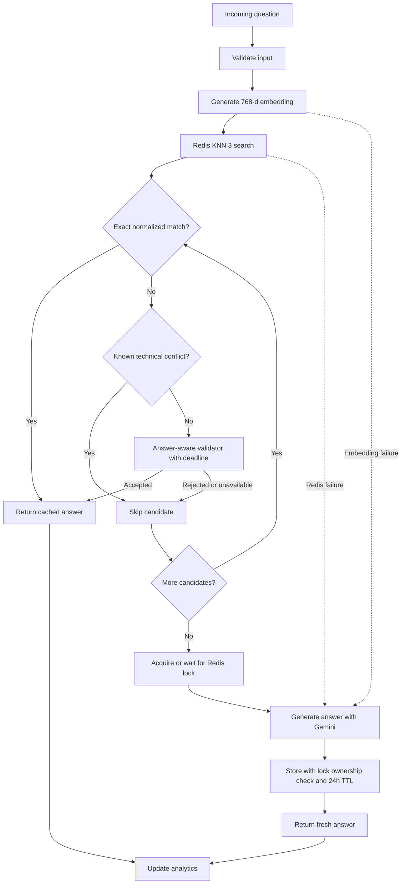

## Live Demo

🌐 [Semantic Cache Dashboard](https://semantic-cache-self.vercel.app)

The backend is deployed on Render, with Redis Cloud
for vector search and Gemini for answer generation.
# Semantic Cache

**Answer-aware semantic caching for LLM responses using Redis vector search, Google Gemini, Node.js, and React.**

Semantic Cache reduces redundant LLM generations by retrieving previously answered questions that are semantically similar to a new request. Rather than trusting cosine similarity alone, the project uses a hybrid validation pipeline that checks whether a cached answer is actually suitable for reuse.

> **Project status:** Working development implementation. Backend regression tests pass (64 tests); live checks cover exact matches, a valid technical paraphrase, a known false-positive scenario, analytics, and concurrent requests. The answer-aware approach still needs larger-scale evaluation before production use.

## Why this project?

Exact-string caching misses paraphrases:

- "What is a binary search tree?"
- "Explain the binary search tree data structure."

Embedding-only caching can be unsafe, though. For example, **"What is a binary tree?"** and **"What is a binary search tree?"** may have high vector similarity while requiring different answers.

This project combines **vector retrieval** with **answer-aware validation** to pursue both cache reuse and correctness.

## Key features

- **Redis vector search:** 768-dimensional `FLOAT32` embeddings, cosine distance, and up to three nearest cache candidates (`KNN 3`).
- **Hybrid matching:** Exact normalized question reuse, known technical-term conflict checks, and Gemini-based answer sufficiency checks for unresolved candidates.
- **Safety-first fallback:** If no candidate is verified, generate a fresh answer rather than blindly reusing a similar response.
- **Bounded validation:** A two-second total selection budget with timeout handling for external validation. The selection deadline does not guarantee that all underlying network work is cancelled.
- **Distributed coordination:** Redis `SET NX PX` locks, token-checked Lua release/renewal, and ownership-checked writes reduce duplicate generation during concurrent requests.
- **Fault tolerance:** Redis or embedding failures can fall back to direct answer generation; API failures are reported.
- **Expiration:** Cached answers expire after 24 hours (86,400 seconds).
- **Observability:** Request counts, hits/misses, response-time averages, Gemini generation calls, failure counts, and observed hit/miss latency ratio.
- **Dashboard:** React dashboard with charts, periodic analytics refresh, connection feedback, and an API Playground.
- **API protection:** Question validation, JSON body limits, request rate limiting, and admin-key protection for administrative routes.
- **Tests:** 64 backend automated tests passing in the latest reported full run.

## Technology stack

| Layer | Technology |
| --- | --- |
| Backend | Node.js, Express.js |
| Vector store and coordination | Redis with Search/vector indexing, Redis hashes and Lua scripts |
| Embeddings and generation | Google Gemini API |
| Optional answer validator | Gemini Flash Lite model (model ID configurable) |
| Frontend | React, Vite, Tailwind CSS, Recharts |
| Testing | Node.js built-in test runner and module mocks |

## Architecture



The initial cache lookup can use answer-aware validation. Subsequent lock-wait, post-lock and pre-storage checks use conservative exact normalized matches, avoiding repeated validator calls in the retry loop.

### Redis index

- Index: `idx:semantic_cache`
- Cache key prefix: `cache:`
- Fields: `question` (TEXT), `answer` (TEXT), `embedding` (VECTOR)
- Vector format: `FLOAT32`, 768 dimensions, cosine distance
- Candidate retrieval: `KNN 3`; candidate threshold: similarity >= `0.90`
- TTL: `86400` seconds

**Note:** Vector similarity is a retrieval signal, not proof that two cached answers are interchangeable.

## Run locally

### Requirements

- Node.js and npm
- A Redis instance with vector-search support (for example, a compatible Redis Cloud database)
- Gemini API credentials with access to the configured models

### 1. Clone and install

```bash
git clone https://github.com/himanshubansal858/semantic-cache.git
cd semantic-cache
npm install
cd dashboard
npm install
cd ..
```

### 2. Configure the backend

Create a `.env` file in the **project root** using the variable names expected by your local configuration in `src/config/redis.js`, embedding service, and LLM service.

The answer-aware validator expects the following environment variables:

```dotenv
GEMINI_API_KEY=your_gemini_api_key
VALIDATOR_GEMINI_MODEL=gemini-3.5-flash-lite
```

Your backend also needs its Redis connection settings and the admin API key if administrative routes are enabled. **Check the actual variable names in `src/config/redis.js` and `src/middleware/adminAuth.js` before configuring them**; they are intentionally not guessed here.

Never commit `.env`, tokens, or Redis credentials. An `.env.example` containing placeholder values is recommended.

### 3. Run the backend

From the project root:

```bash
npm run dev
```

The API is expected at `http://127.0.0.1:5000` in the current development setup.

On Windows PowerShell, use `npm.cmd run dev` if the `npm.ps1` execution policy blocks `npm`.

### 4. Run the dashboard

In another terminal:

```bash
cd dashboard
npm run dev
```

Open the URL printed by Vite (typically `http://localhost:5173`). The dashboard requires the backend to be running for live analytics. If the backend is stopped, it may display the last fetched metrics and an "Analytics API unavailable" warning.

## API examples

### Ask a question

`POST /api/ask`

```bash
curl -X POST http://127.0.0.1:5000/api/ask \
  -H 'Content-Type: application/json' \
  -d '{"question":"What is a binary search tree?"}'
```

**Example cache-hit response** (illustrative):

```json
{
  "success": true,
  "question": "What is a binary search tree?",
  "answer": "A binary search tree is ...",
  "cache": {
    "hit": true,
    "similarity": 0.99,
    "redisAvailable": true
  }
}
```

Cache-miss responses may include `cache.stored` and a status message. Exact fields can vary by outcome.

### Fetch analytics

`GET /api/analytics`

```bash
curl http://127.0.0.1:5000/api/analytics
```

Administrative cache deletion and analytics-reset operations require the configured admin key; consult the backend routes for the exact paths and headers.

## Observed results

The latest **development dashboard snapshot** supplied during testing showed:

| Metric | Value |
| --- | ---: |
| Total requests | 34 |
| Cache hits | 17 |
| Cache misses | 17 |
| Cache hit rate | 50.00% |
| Gemini generation calls (reported) | 16 |
| Failed requests | 2 |
| Observed average miss/hit latency ratio | 38.94x |

**Interpretation:** These are cumulative development metrics, not a controlled benchmark or guaranteed production speedup. They can include earlier code versions and different question lengths, model response times, retries, and network conditions. The `geminiCalls` metric may not include answer-validation API calls.

### Validation experiments

| Experiment | Observed result | Caveat |
| --- | --- | --- |
| Embedding similarity threshold | 60% accuracy on 10 labeled pairs | False positives on related concepts |
| Local duplicate-question cross-encoder | 50% accuracy on 16 technical pairs | Failed to identify positive paraphrases |
| Bidirectional NLI | 66.67% accuracy on a 12-pair held-out set | Two false positives |
| Gemini answer-aware validator | 8/8 correct on eight offline answer-sufficiency examples | Very small, non-independent sample; mean ~753 ms per validation |

A live paraphrase (BST question phrased differently) returned a cache hit with ~0.966 similarity and ~3.48 s end-to-end latency. A separate binary-tree question did **not** reuse a BST-specific response and instead generated a new answer. These are individual observed cases, not broad correctness guarantees.

### Concurrency observation

In a two-request fresh-question test, **one answer generation** was recorded. One request generated and stored its response; the other received HTTP `503` after its bounded lock wait expired because generation was slow. This supports duplicate-generation prevention in that test, but **does not mean both concurrent requests always succeed**.

## Testing and build

Run the backend test suite:

```bash
node --experimental-test-module-mocks --test
```

Latest reported full regression result: **64 passed, 0 failed**.

Run the frontend quality checks:

```bash
cd dashboard
npm run lint
npm run build
```

Both passed in the latest reported build. Vite emitted a non-blocking warning about a JavaScript chunk larger than 500 kB (approximately 646 kB before gzip, 190 kB gzipped).

The `evaluation/` folder contains experiments and benchmarks. Some scripts make real Gemini API calls and consume quota; review their model and API configuration before running them.

## Design choices and limitations

1. **Answer correctness:** A retrieved question may be semantically close yet require a different answer. The hybrid validator reduces some known false positives but is not infallible.
2. **Exact-match trust:** Exact normalized matches bypass answer sufficiency verification, assuming the cached answer was acceptable when stored.
3. **Candidate coverage:** `KNN 3` can miss an appropriate answer that is not among the nearest three results. It is not a guaranteed exact-key lookup.
4. **Model latency and quota:** Answer-aware checks introduce external network calls. They may time out or fail closed, converting potentially reusable answers into misses.
5. **Timeout semantics:** A selector deadline stops waiting, but does not necessarily terminate server-side provider work.
6. **Concurrency:** Lock wait is bounded; callers can receive `503` while another request is still generating an answer.
7. **Measurement:** Dashboard data reflects development traffic rather than a standardized load test. Cached responses and model outputs should not be assumed correct for all inputs.

## Future improvements

- A dedicated normalized-question key for reliable exact lookup and deduplication.
- Larger, independently labeled answer-reuse evaluation sets and calibration.
- An optional request-status or job polling endpoint for slow generations.
- Tighter instrumentation separating validation API calls from generation calls.
- Frontend code splitting and controlled end-to-end latency/load benchmarks.

## Repository

[GitHub — himanshubansal858/semantic-cache](https://github.com/himanshubansal858/semantic-cache)
